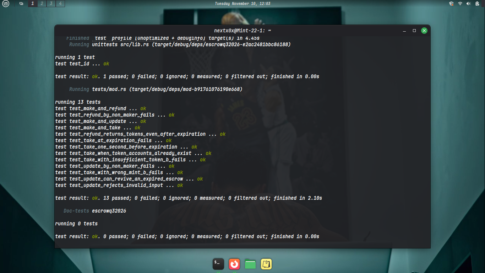

# Escrow Program: Solana · Anchor · LiteSVM

A trustless token-swap **escrow** written in Rust with [Anchor](https://www.anchor-lang.com/) and tested end to end with [LiteSVM](https://github.com/LiteSVM/litesvm).

One person (the **maker**) locks some of token A in a vault and says what they want in return (an amount of token B, within a deadline). Another person (the **taker**) can accept the offer, and the swap happens atomically: either both sides get paid, or nothing moves. If nobody takes the offer, the maker can always get their tokens back.

This repo is also my learning log: it documents what I built, the bugs I hit, and what I learned along the way.

---

## Test results



> All 13 tests pass. They run with **LiteSVM**, a fast in-process Solana VM, so there is no validator to start.

## How it works

```
 maker                         vault (PDA-owned)                    taker
   │  make: lock `deposit` of A      │                                │
   ├────────────────────────────────►│                                │
   │                                 │   take: pay `receive` of B     │
   │◄────────────────────────────────┼────────────────────────────────┤
   │                                 │   take: receive all of A       │
   │                                 ├───────────────────────────────►│
   │  refund (any time, maker only): the vault goes back to the maker │
   │◄────────────────────────────────┤                                │
```

- The deposit sits in a **vault**: a token account whose owner is the escrow PDA, so only the program can move it.
- `take` is one transaction, so the swap is atomic.
- An offer can be taken while `now < expiration`. `refund` works at any time.
- The maker can change the price and/or the deadline with `update`.

---

## Instructions

| #   | Instruction | Signer | What it does                                                                                                            |
| --- | ----------- | ------ | ----------------------------------------------------------------------------------------------------------------------- |
| 0   | `make`      | maker  | Creates the escrow account and moves `deposit` of token A into the vault.                                               |
| 1   | `take`      | taker  | Pays the maker `receive` of token B, sends the whole vault (token A) to the taker, and closes the vault and the escrow. |
| 2   | `refund`    | maker  | Sends the vault back to the maker and closes the vault and the escrow.                                                  |
| 3   | `update`    | maker  | Changes the price (`receive`) and/or the deadline (`expiration`) of an open offer.                                      |

The instruction discriminators are custom single bytes (`#[instruction(discriminator = N)]`).

### `make(seed, deposit, receive, expiration)`

1. **Init escrow:** stores `seed`, `maker`, `mint_a`, `mint_b`, `receive`, `expiration` and the PDA `bump`.
2. **Deposit:** transfers `deposit` of token A from `maker_ata_a` to the `vault`.


### `take()`

Three moves in one transaction:

1. **Pay the maker:** `taker_ata_b` → `maker_ata_b`, `escrow.receive` of token B.
2. **Withdraw:** `vault` → `taker_ata_a`, everything in the vault, signed by the escrow PDA.
3. **Close:** the vault is closed (rent goes to the taker) and the escrow is closed (rent goes back to the maker).

`taker_ata_a` and `maker_ata_b` use `init_if_needed`: neither side necessarily holds the other token yet, so the taker pays to create those accounts when they are missing. Before anything moves, `take` checks that the offer has not expired.


### `refund()`

Moves the whole vault back to `maker_ata_a`, then closes the vault and the escrow. It deliberately has **no expiry check**: if no taker shows up, the maker can always reclaim their tokens.


### `update(receive: Option<u64>, expiration: Option<i64>)`

Lets the maker change the terms of an open offer. `None` means "leave this field as it is".

- Only the maker can call it.
- It still works after the deadline has passed. That is how a maker revives an expired offer without refunding and starting over.
- A new `receive` must be greater than zero.
- A new `expiration` must be in the future.
- Passing both as `None` is rejected, because it is almost certainly a mistake.

---

## Account design

### `Escrow` (state)

| Field        | Type     | Meaning                                                      |
| ------------ | -------- | ------------------------------------------------------------ |
| `seed`       | `u64`    | Lets one maker open many escrows.                            |
| `maker`      | `Pubkey` | Who created the offer.                                       |
| `mint_a`     | `Pubkey` | The token the maker deposits.                                |
| `mint_b`     | `Pubkey` | The token the maker wants.                                   |
| `receive`    | `u64`    | How much of token B the maker wants.                         |
| `expiration` | `i64`    | Unix timestamp after which the offer can no longer be taken. |
| `bump`       | `u8`     | Canonical PDA bump.                                          |

### PDAs

- **Escrow:** `["escrow", maker, seed.to_le_bytes()]`
- **Vault:** the associated token account of `mint_a` owned by the escrow PDA. Because the owner is a PDA, nobody holds its key; the program signs for it with the escrow's seeds.

---

## Errors

| Code | Name                | Raised when                                               |
| ---- | ------------------- | --------------------------------------------------------- |
| 6000 | `EscrowExpired`     | A `take` happens at or after the expiration time.         |
| 6001 | `InvalidExpiration` | `update` is given a deadline that is not in the future.   |
| 6002 | `InvalidAmount`     | `update` is given a price of zero.                        |
| 6003 | `NothingToUpdate`   | `update` is called with no new price and no new deadline. |

Custom program errors start at 6000. Anchor's own constraint errors use the 2000s (for example `ConstraintSeeds` = 2006 and `ConstraintHasOne` = 2001), and the token program has its own small numbers.

---

## Security checks

| Attack or mistake                            | What stops it                                                                                              |
| -------------------------------------------- | ---------------------------------------------------------------------------------------------------------- |
| Someone passes a fake escrow                 | `seeds` + `bump` prove the account is the real PDA for this maker and seed.                                |
| Taker pays with a worthless look-alike token | `has_one = mint_a` and `has_one = mint_b` pin both mints to the ones stored in the escrow.                 |
| Someone else refunds or updates an offer     | The escrow address is derived from the maker's key, so another signer cannot match it (`ConstraintSeeds`). |
| Taking an expired offer                      | The expiry check in `take` returns `EscrowExpired`.                                                        |
| Taking the same offer twice                  | `take` closes the escrow, so a second attempt finds no account.                                            |
| Moving the vault without the program         | The vault is owned by the escrow PDA, and only the program can sign for it.                                |
| Paying less than the maker asked             | The transfer amount is read from the escrow state, never from the taker.                                   |

---

## Project structure

```
.
├── Anchor.toml
├── Cargo.toml
├── arch/                         # architecture diagrams (make, take, refund)
├── escrow-tests-passed.png       # test screenshot (add yours)
└── programs/escrowq32026/
    ├── src/
    │   ├── lib.rs                # program entrypoint: make / take / refund / update
    │   ├── constants.rs          # ESCROW_SEED
    │   ├── error.rs              # custom errors
    │   ├── state.rs              # Escrow account
    │   ├── instructions.rs
    │   └── instructions/
    │       ├── make.rs
    │       ├── take.rs
    │       ├── refund.rs
    │       └── update.rs
    └── tests/
        └── mod.rs                # LiteSVM tests
```

---

## Tests (LiteSVM)

The tests use **[LiteSVM](https://github.com/LiteSVM/litesvm)**. It runs the compiled program inside the test process, so the whole suite finishes in a few seconds. LiteSVM also lets me set the on-chain clock directly, which is how the expiry logic gets tested.

Every test starts from the same world (`fixture()`): the maker holds 1,000 token A, the taker holds 1,000 token B, and the clock is fixed at a known time. Each test has a `Tests:` comment (the scenario) and an `Against:` comment (what it is checked against).

| #   | Test                                               | Tests                                                   | Against                                                                           |
| --- | -------------------------------------------------- | ------------------------------------------------------- | --------------------------------------------------------------------------------- |
| 1   | `test_make_and_take`                               | make, then take: the full happy path                    | Correct balances, escrow and vault closed, rent back to the maker, no second take |
| 2   | `test_take_when_token_accounts_already_exist`      | take when both destination token accounts already exist | Same result as the create-them path (`init_if_needed`)                            |
| 3   | `test_take_one_second_before_expiration`           | take 1 second before the deadline                       | The offer is still open                                                           |
| 4   | `test_take_at_expiration_fails`                    | take exactly at the deadline                            | `EscrowExpired`, and nothing moves                                                |
| 5   | `test_take_with_insufficient_token_b_fails`        | the taker holds less token B than asked                 | The token program's `InsufficientFunds`                                           |
| 6   | `test_take_with_wrong_mint_b_fails`                | the taker pays with a fake token                        | `has_one = mint_b` (`ConstraintHasOne`)                                           |
| 7   | `test_make_and_refund`                             | make, then refund                                       | Escrow and vault closed                                                           |
| 8   | `test_refund_returns_tokens_even_after_expiration` | refund long after the offer expired                     | The maker gets everything back at any time                                        |
| 9   | `test_refund_by_non_maker_fails`                   | someone else signs as the maker                         | `ConstraintSeeds`                                                                 |
| 10  | `test_make_and_update`                             | update the price, then the deadline, then take          | Each update changes only its own field, and the next take pays the new price      |
| 11  | `test_update_can_revive_an_expired_escrow`         | update the deadline of an expired offer                 | The offer becomes takeable again                                                  |
| 12  | `test_update_rejects_invalid_input`                | nothing to change, zero price, past deadline            | `NothingToUpdate`, `InvalidAmount`, `InvalidExpiration`                           |
| 13  | `test_update_by_non_maker_fails`                   | someone else tries to change the price                  | `ConstraintSeeds`                                                                 |

---

### Build and test

```bash
git clone https://github.com/next0shi/tubine-escrow-q4.git
cd tubine-escrow-q4

anchor build     # compiles the program to target/deploy/escrowq32026.so
cargo test       # runs the LiteSVM tests (or: anchor test, which does both)
```

> **Build before you test.** The tests load the compiled `target/deploy/escrowq32026.so`. Running `cargo test` alone reuses an old `.so` if one exists.

---

## What I learned

**Program design**

- **PDAs are the program's identity.** The escrow PDA stores the offer and also owns the vault, so no private key can ever move the deposit. The program proves ownership by signing CPIs with the escrow's seeds.
- **Anchor constraints do the heavy lifting.** `seeds` + `bump`, `has_one`, `close` and `init_if_needed` replace a lot of manual checks, and each one maps to a specific attack in the table above.
- **Token transfers are CPIs.** I used `transfer_checked` and `close_account` from `anchor_spl::token_interface`, signing with the escrow seeds where the vault is the source.
- **Closing accounts matters.** `close` returns the rent, and it makes a finished offer impossible to reuse.
- **Custom discriminators** (`discriminator = 0..3`) keep instruction data tiny.
- **`Option<T>` arguments** make partial updates easy: pass only what should change.

**A real bug: the 4 KB stack limit**
My first `take` passed the tests on one toolchain and failed on another with `Access violation in stack frame`, after only about 3.5k compute units. The cause was that `Take` has 12 accounts, and holding them all inline needs more than the 4 KB stack a Solana function gets. `anchor build` had printed a warning like this and still succeeded:

```
Stack offset of 4504 exceeded max offset of 4096 ... Take ... try_accounts
```

The fix was to wrap the large accounts in `Box<...>` so they live on the heap. Lesson: **never ignore that warning**, because it only turns into a failure at runtime, and only on some compiler versions.

**Testing with LiteSVM**

- **Load the compiled program** into the in-process VM, then drive it with ordinary transactions.
- **Move time on purpose** with `set_sysvar::<Clock>(...)`. That is how I test "one second before" and "exactly at" the deadline.
- **Make every transaction unique.** LiteSVM rejects an identical transaction as `AlreadyProcessed`, so the test helper expires the blockhash before each send.
- **Assert the exact error**, not just "it failed". A test that checks for `Custom(6000)` is much harder to pass for the wrong reason.
- **Closed accounts disappear**, so `get_account(..)` returns `None` after a successful take or refund.
- **A failed transaction changes nothing.** I assert that balances and accounts are untouched after each failure.
- **Test boundaries.** Whether an offer is open at exactly `expiration` is a decision, and the tests pin it down.
- **Build helpers once.** A `fixture()` plus one method per instruction (`f.take()`, `f.update(..)`) keeps each test short and readable.

**Thinking like an attacker**

- Paying with a **fake token** is the classic escrow attack, and `has_one = mint_b` stops it.
- A signer who **pretends to be the maker** fails because the escrow address is derived from the real maker's key.
- Every rule has a test that tries to break it.

---

## Design decisions and limitations

- **Expiry:** an offer is open while `now < expiration`. `refund` ignores expiry on purpose.
- **Rent:** the vault's rent goes to the taker on `take` (they pay for the new token accounts), and the escrow's rent goes back to the maker.
- **Whole vault:** `take` sends everything in the vault to the taker, because the vault has to be empty before it can be closed.
- **`update` changes terms live.** A taker whose transaction was prepared against the old price will pay the new one. A production version should let `take` accept the expected `receive` and fail if it differs.
- **`make` does not validate its inputs.** Zero amounts and past expirations are accepted. Adding `require!` checks is a small change.
